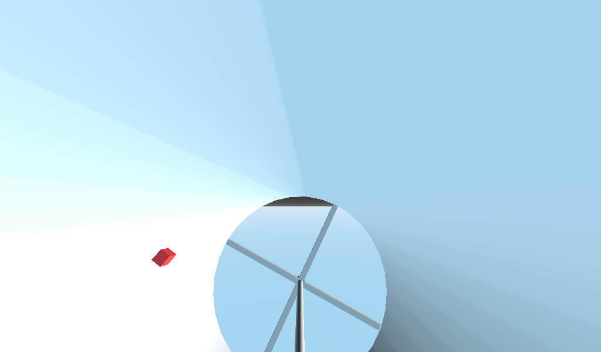

# tangentscraps/gravitube

> "Just a godot scene" — an experiment in modeling artificial gravity: two
> counter-rotating habitat tubes with a physics test cube inside.
> Repo: https://github.com/tangentscraps/gravitube — 11 files, 2 commits. Last pushed 2020-11-16.

## Screenshot

Rendered 2026-10-20 from the actual `Spatial.tscn` main scene (Godot 3.6.3,
software rendering). The camera sits beside the starboard tube; the red cube and
the hub's spoke cap are visible.



## What it is

**Gravitube** is a Godot 3 scene modeling a rotating space habitat — the classic
"spin the tube for artificial gravity" idea. Two tube assemblies ("port" and
"starboard") sit side by side, spinning in opposite directions at ±12°/second.
Each tube is a hollow CSG cylinder (outer radius 33, inner 32, height 128) around
a central hub with cross-shaped spoke caps at each end. A small red RigidBody
cube floats inside the starboard tube — a physics test object to watch behave
inside the rotating frame. The scene also has a Camera (fov 94.9), an omni light,
a directional light, and a procedural-sky environment.

The whole thing is an experiment, per the commit messages: *"attempt to model
artificial gravity in godot"* followed by *"more geometry"*.

## Tech stack

Godot 3 (project `config_version=4`), GDScript, CSG geometry. One tiny script:

```gdscript
extends Spatial
export var speed : int = 0
func _process(delta):
	rotation_degrees.x += speed * delta
```

The script defaults `speed` to 0; the scene sets `speed = -12` (port) and
`speed = 12` (starboard) on the instances.

## Inventory

| Path | Contents |
|------|----------|
| `Spatial.tscn` | Main scene: two gravitube instances (±50 z, speeds ∓12), red RigidBody cube, lights, camera, procedural sky |
| `gravitube.tscn` | The tube assembly: script + hub (2 CSGCylinders, height 132) + spoke caps + instanced Shell |
| `Shell.tscn` | Hollow shell: outer CSGCylinder (r=33, h=128, 32 sides) with inner cylinder subtracted (operation=2) |
| `gravitube.gd` | Spin script (above) |
| `project.godot` | Project config (`config/name="gravitube"`, main scene `Spatial.tscn`) |
| `default_env.tres` | Default environment |
| `icon.png` | The stock Godot engine icon — not a scene screenshot |
| `.import/` | Godot 3 import cache for the icon |

## Surprising / notable

- Despite being an artificial-gravity experiment, nothing in the scene applies
  centrifugal force — the cube is just a RigidBody in a rotating visual frame;
  the "gravity" part was never modeled. (Verified: no physics code beyond the
  spin script.)
- The camera placement means you mostly see one tube's end cap and the red cube;
  the full twin-tube arrangement isn't visible in a single default view.
- No linked streams or videos found in the repo.
